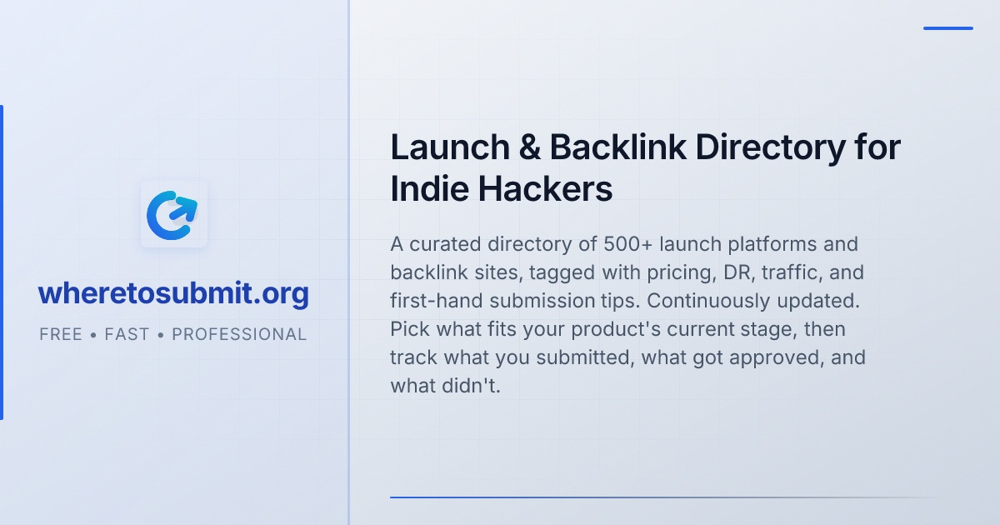

<p align="center">
  <a href="https://wheretosubmit.org"></a>
</p>

<p align="center">English · <a href="README.zh.md">简体中文</a></p>

# Where To Submit agent skill

This repository lets your AI agent submit your product to the directories and
launch sites listed on [wheretosubmit.org](https://wheretosubmit.org). It holds
one skill, `wheretosubmit-submit`, and the setup for the Where To Submit MCP
server. The MCP server tells the agent which sites to try next and stores your
progress in your Where To Submit account. The skill tells the agent how to do
the work: fill each site's form in a real browser from a local product
profile, one site at a time, and record what happened.

## What you need

- A [wheretosubmit.org](https://wheretosubmit.org) account. Reading targets
  works on every plan. Recording progress (`mark_status`) and creating
  projects need Pro.
- An MCP token. Sign in, open **Account**, find **MCP for AI agents**, give
  the token a name and click **Generate token**. Copy it right away, it is
  shown once. It starts with `wts_`. Treat it like a password.
- A browser tool in your agent. We run our own submissions with
  [ego-browser](https://lite.ego.app/) (macOS and Windows): the agent and you
  share one window, so you can watch it fill a form and take over a CAPTCHA
  without switching anything. Claude in Chrome, the Claude desktop built-in
  browser and Playwright MCP work too. Without one the agent stops.
- Optional: a mail tool (Gmail MCP, an IMAP script, or similar) for sites
  that confirm by email. Without one, those sites are skipped.
- Optional: Node 20+ to run the profile check script.

## Install

Pick one route. Don't combine route 1 with a manual `claude mcp add` of the
same server, or you get the tools twice.

### 1. Claude Code plugin (skill and MCP together)

Set your token in the shell profile Claude Code starts from (for example
`~/.zshrc` or `~/.bashrc`), then open a new terminal:

```sh
export WHERETOSUBMIT_TOKEN=wts_...
```

In a Claude Code session, add the marketplace and install the plugin:

```
/plugin marketplace add johnwick7zz/wheretosubmit-backlink-skill
/plugin install wheretosubmit@wheretosubmit
```

Or from your shell:

```sh
claude plugin marketplace add johnwick7zz/wheretosubmit-backlink-skill
claude plugin install wheretosubmit@wheretosubmit
```

The short `owner/repo` form is GitHub shorthand. Add `#v0.1.0` or a branch
name after it to pin a version.

The plugin's MCP config sends `Authorization: Bearer ${WHERETOSUBMIT_TOKEN}`,
and Claude Code fills in the variable when it starts. Run `/mcp` to check that
the `wheretosubmit` server is connected. If it shows a missing-variable
warning or a 401, the variable wasn't set in the shell that started Claude
Code: set it and restart.

If you'd rather not keep the token in an environment variable, turn the
plugin's server off in `/mcp` and add the server yourself:

```sh
claude mcp add --transport http wheretosubmit https://wheretosubmit.org/api/mcp --header "Authorization: Bearer wts_..."
```

To get a new version later: `claude plugin update wheretosubmit@wheretosubmit`,
or turn on auto-update for the `wheretosubmit` marketplace under
**Marketplaces** in `/plugin`.

### 2. Other agents, with the skills CLI

The [skills](https://skills.sh) CLI finds the skill in `skills/`:

```sh
npx skills add johnwick7zz/wheretosubmit-backlink-skill
```

Add `-g` to install it for all your projects, or `-a <agent>` to pick the
agent. Then connect the MCP server in your agent's own config, see
[docs/mcp.md](docs/mcp.md). For Cursor, for example, put this in
`~/.cursor/mcp.json`:

```json
{
  "mcpServers": {
    "wheretosubmit": {
      "type": "http",
      "url": "https://wheretosubmit.org/api/mcp",
      "headers": { "Authorization": "Bearer wts_..." }
    }
  }
}
```

### 3. Manual copy

Download the repository archive from
<https://github.com/johnwick7zz/wheretosubmit-backlink-skill> (Code, Download ZIP) and unpack it. Copy the skill folder to where your agent loads skills.
For Claude Code, for all projects:

```sh
cp -R skills/wheretosubmit-submit ~/.claude/skills/
```

Or for one project only, from that project's root:

```sh
mkdir -p .claude/skills && cp -R /path/to/wheretosubmit-backlink-skill/skills/wheretosubmit-submit .claude/skills/
```

Then connect the MCP server with the `claude mcp add` command above (or your
agent's MCP config) and restart the session.

## First run

Ask your agent something like "Submit my product to 10 free directories" or
"Continue my directory submissions". On the first run it will:

1. Call `list_projects` to check the MCP connection and your plan. If the
   tool is missing or the token is wrong, it stops and tells you.
2. Find your product URL and match it to one of your Where To Submit projects.
   It asks before reusing one and before creating a new one.
3. Create a workspace at `./.wheretosubmit/` in your project, with
   `profile.json`, `assets/` and `evidence/`. It drafts the profile from your
   website and asks you to confirm the facts. Unknown facts stay empty.
4. Run the preflight check on the profile:
   `node <skill-folder>/scripts/preflight.mjs --dir ./.wheretosubmit`.
   Exit 0 means ready.
5. Check whether it can read your mailbox. If not, it skips sites that need
   email verification or an account.
6. Pick targets with `next_targets` and submit one site at a time, recording
   each result with `mark_status`.

Your product data stays in `.wheretosubmit/` on your machine. Only each site's
status and a short evidence note go to wheretosubmit.org. Add
`.wheretosubmit/evidence/` to your project's `.gitignore`.

## What the agent never does

- Pay for anything. With paid sites allowed, it stops at the checkout page and
  hands it to you.
- Register accounts or create passwords, unless you allow it.
- Solve or bypass CAPTCHAs. It fills the form and hands the CAPTCHA to you.
- Invent facts. It only uses your profile and answers you gave.
- Submit to the same site twice, or mark a site submitted without seeing a
  confirmation.
- Edit your website. If a site wants a badge or backlink, it lists what's
  needed.

## More

- [docs/mcp.md](docs/mcp.md): MCP setup, tools, statuses, follow-ups and error
  codes.
- [skills/wheretosubmit-submit/SKILL.md](skills/wheretosubmit-submit/SKILL.md):
  the full workflow the agent follows.
- [CHANGELOG.md](CHANGELOG.md)

## License

MIT, see [LICENSE](LICENSE).
