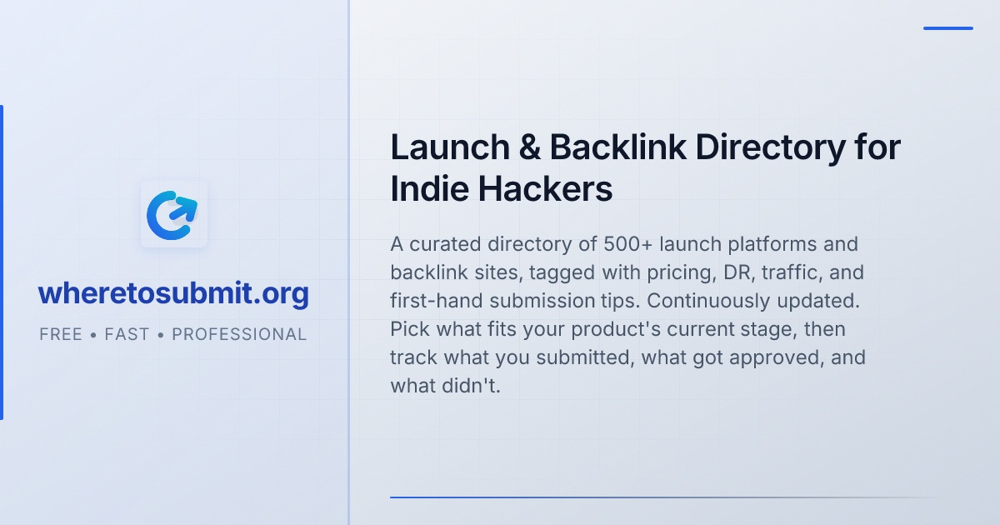

<p align="center">
  <a href="https://wheretosubmit.org"></a>
</p>

<p align="center"><a href="README.md">English</a> · 简体中文</p>

# Where To Submit 提交 Skill

这个仓库让你的 AI agent 替你把产品提交到 [wheretosubmit.org](https://wheretosubmit.org) 收录的那些目录站和发布平台。里面有一个 skill，`wheretosubmit-submit`，加上接 Where To Submit MCP 服务的配置。MCP 负责告诉 agent 下一个该投哪个站，并把进度记到你的 Where To Submit 账户里；skill 负责教 agent 怎么干活：在真实浏览器里，拿你电脑上的产品资料，一个站一个站地填表，填完把结果记回来。

## 需要准备什么

- 一个 [wheretosubmit.org](https://wheretosubmit.org) 账户。读目标站所有套餐都行，记录进度（`mark_status`）和建项目要 Pro。
- 一个 MCP 令牌。登录后打开 **账户** 页，找到 **MCP（给 AI agent 用）**，起个名字，点 **生成令牌**。马上复制，它只显示这一次，开头是 `wts_`，当密码保管。
- agent 里要有浏览器工具：Claude in Chrome、Claude 桌面版自带的浏览器、Playwright MCP 之类。没有的话 agent 会直接停下。
- 可选：一个能读邮件的工具（Gmail MCP、IMAP 脚本之类），给要邮件确认的站用。没有就跳过那些站。
- 可选：Node 20 以上，用来跑资料检查脚本。

## 安装

三种装法挑一种。装了插件就别再手动 `claude mcp add` 同一个服务，不然 agent 会看到两套一样的工具。

### 1. Claude Code 插件（skill 和 MCP 一起装）

先把令牌写进 Claude Code 启动时读的 shell 配置（比如 `~/.zshrc` 或 `~/.bashrc`），然后开个新终端：

```sh
export WHERETOSUBMIT_TOKEN=wts_...
```

在 Claude Code 会话里加市场、装插件：

```
/plugin marketplace add johnwick7zz/wheretosubmit-backlink-skill
/plugin install wheretosubmit@wheretosubmit
```

或者在终端里跑：

```sh
claude plugin marketplace add johnwick7zz/wheretosubmit-backlink-skill
claude plugin install wheretosubmit@wheretosubmit
```

`owner/repo` 这种短写法是 GitHub 专用的。后面加 `#v0.1.0` 或分支名可以锁定版本。

插件自带的 MCP 配置会发 `Authorization: Bearer ${WHERETOSUBMIT_TOKEN}`，Claude Code 启动时把变量填进去。跑 `/mcp` 看 `wheretosubmit` 这个服务有没有连上。要是提示变量缺失或者 401，说明启动 Claude Code 的那个 shell 里没设变量，设好重启就行。

不想把令牌放环境变量的话，在 `/mcp` 里把插件的服务关掉，自己加一个：

```sh
claude mcp add --transport http wheretosubmit https://wheretosubmit.org/api/mcp --header "Authorization: Bearer wts_..."
```

以后更新：`claude plugin update wheretosubmit@wheretosubmit`，或者在 `/plugin` 的 **Marketplaces** 里给 `wheretosubmit` 市场打开自动更新。

### 2. 其他 agent，用 skills 命令行

[skills](https://skills.sh) 这个命令行工具会自动在 `skills/` 里找到 skill：

```sh
npx skills add johnwick7zz/wheretosubmit-backlink-skill
```

加 `-g` 装成全局，加 `-a <agent>` 指定 agent。然后在你的 agent 自己的配置里接上 MCP 服务，见 [docs/mcp.md](docs/mcp.md)。拿 Cursor 举例，把下面这段放进 `~/.cursor/mcp.json`：

```json
{
  "mcpServers": {
    "wheretosubmit": {
      "type": "http",
      "url": "https://wheretosubmit.org/api/mcp",
      "headers": { "Authorization": "Bearer wts_..." }
    }
  }
}
```

### 3. 手动复制

从 <https://github.com/johnwick7zz/wheretosubmit-backlink-skill> 下载压缩包（Code，Download ZIP）解开，把 skill 文件夹拷到你的 agent 读 skill 的地方。Claude Code 全局装：

```sh
cp -R skills/wheretosubmit-submit ~/.claude/skills/
```

只给某一个项目用的话，在那个项目根目录跑：

```sh
mkdir -p .claude/skills && cp -R /path/to/wheretosubmit-backlink-skill/skills/wheretosubmit-submit .claude/skills/
```

然后用上面那条 `claude mcp add`（或者你 agent 自己的 MCP 配置）接上服务，重开会话。

## 第一次运行

跟 agent 说一句「把我的产品提交到 10 个免费目录站」或者「接着做目录提交」就行。第一次跑它会：

1. 调 `list_projects` 确认 MCP 连上了、你是什么套餐。工具不在或者令牌不对，它会停下来告诉你。
2. 找到你的产品网址，和你 Where To Submit 里的项目对上。复用已有项目或者新建，都会先问你。
3. 在你的项目里建一个 `./.wheretosubmit/` 工作区，放 `profile.json`、`assets/` 和 `evidence/`。资料它会照着你的网站先写一版，再让你确认事实。不知道的留空，不瞎编。
4. 跑一遍资料检查：`node <skill目录>/scripts/preflight.mjs --dir ./.wheretosubmit`，退出码 0 就是准备好了。
5. 试一下能不能读你的邮箱。读不了就跳过那些要邮件验证或者要注册账号的站。
6. 用 `next_targets` 挑站，一个站一个站提交，每个结果都用 `mark_status` 记回去。

产品资料一直在你电脑上的 `.wheretosubmit/` 里，只有每个站的状态和一句简短的证据会传到 wheretosubmit.org。记得把 `.wheretosubmit/evidence/` 加进项目的 `.gitignore`。

## agent 绝不做的事

- 付钱。就算你允许提交付费站，它也只走到结算页，然后交给你。
- 注册账号、建密码，除非你明确允许。
- 解验证码或者绕过验证码。它把表填好，验证码留给你点。
- 编造事实。只用你的资料和你给的答案。
- 同一个站提交两次，或者没看到确认页就标成已提交。
- 改你的网站。站方要求挂徽章或者加回链，它只把要求列出来给你。

## 更多

- [docs/mcp.md](docs/mcp.md)：MCP 的接入、工具、状态、待办和错误码。
- [skills/wheretosubmit-submit/SKILL.md](skills/wheretosubmit-submit/SKILL.md)：agent 遵循的完整流程。
- [CHANGELOG.md](CHANGELOG.md)

## 许可

MIT，见 [LICENSE](LICENSE)。
